<picture>
  <source media="(prefers-color-scheme: dark)" srcset="assets/banner-dark.svg">
  
</picture>

i like being slightly in over my head.

studying cs + ai at **waterloo** 
swe at **shopify** 
looking for **summer 2027** internships

- **[watched.earth](https://github.com/dev-Armaan/satellites)** &nbsp;every public satellite image of earth
- **[arXivisual](https://arxivisual.org)** &nbsp;research papers as 3blue1brown-style animations. tartanhacks '26 winner
- **[CageFantasy](https://cagefantasy.com)** &nbsp;fantasy picks for mma. #1 ufc fantasy app on the app store

[armaan.world](https://www.armaan.world) &nbsp;&nbsp;&nbsp; [linkedin](https://www.linkedin.com/in/gupta-armaan/) &nbsp;&nbsp;&nbsp; [x](https://x.com/armaangupt0) &nbsp;&nbsp;&nbsp; [email](mailto:a585gupt@uwaterloo.ca)
